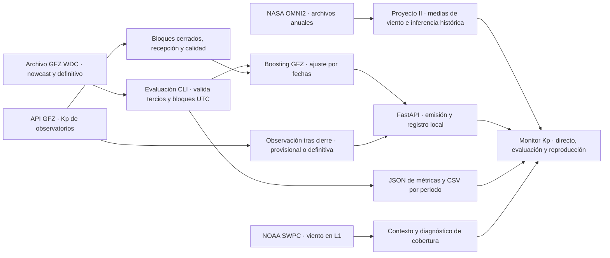

# Proyecto I: ventas y datos geomagnéticos

[Arranque y demo del Proyecto III](#proyecto-iii-aplicaci%C3%B3n-de-pron%C3%B3stico-geomagn%C3%A9tico)

Este proyecto reúne el pipeline de ventas del curso y otro con datos de NASA OMNI. En ambos cargo y valido los datos, calculo métricas y guardo los resultados desde la terminal. Elegí OMNI por mi interés en una futura predicción de Kp; aquí trabajo con la calidad de los datos.

## Organización

El código está en `src/ventas_app/` y `src/pronostico_geomagnetico/`, y sus pruebas en `tests/ventas/` y `tests/geomagnetico/`. Los datasets se descargan en `data/` (excluida de Git) y los notebooks en `notebooks/`.

En ventas utilizo `SalesRepository` y `CsvSalesRepository`, siguiendo el ejemplo de clase. Los principios SOLID aplicados están explicados en [DESIGN.md](src/ventas_app/DESIGN.md).

## Ejecución

Desde la raíz del repositorio, con Python 3.12:

```bash
python -m pip install -r requirements.txt
python scripts/download_data.py
python -m src.ventas_app.cli --input data/ventas.csv --output data/processed/ventas_validas.csv
python -m src.pronostico_geomagnetico.cli --input data/raw/omni2_2000.dat --output data/processed/metrics_2000.json
```

Ventas genera el CSV limpio, `calidad_datos.json` con recuentos e importe total y `metricas_ventas.json` con importe por región, los tres productos con mayor importe y clientes recurrentes.

OMNI genera un JSON con total de filas, filas completas e incompletas y porcentaje de completas, considerando Bz, densidad de protones, velocidad del viento solar y Kp. Para abrir los notebooks hace falta Jupyter.

## Validación

- **Ventas:** unidades y precio numéricos y mayores que cero. Se separan las filas inválidas y se calcula el importe de las válidas. El CSV del curso tiene **140 válidas y 10 inválidas**.
- **OMNI:** 55 columnas, fecha y hora válidas, años bisiestos y ausencia de instantes duplicados. Los códigos de datos ausentes se convierten a `NaN` en las cuatro variables seleccionadas.

Ambas aplicaciones utilizan excepciones propias para los errores de carga y validación.

## Tests y CI

```bash
python -m pytest -q
python -m pytest -q -m "not integration"
python -m pytest tests --cov=src.ventas_app --cov=src.pronostico_geomagnetico --cov-report=term-missing --cov-fail-under=60
```

Las pruebas usan datos en memoria, archivos temporales y los datasets descargados. Los tests no usan red; la descarga inicial sí la necesita. El 12 de octubre de 2026 pasaron **55 tests con un 98,15 % de cobertura** en local, con Python 3.14.

El workflow `.github/workflows/ci.yml` comprueba ambas partes con Python 3.12 en pushes a `main` y pull requests, con cobertura mínima del 60 %.

[Ver Actions](https://github.com/AlvaroPRuiiz/pronostico-geomagnetico/actions) ·


## Datos

Ventas procede de `3_automatizacion_e_ia/Datos/ventas.csv` del repositorio del curso.

OMNI procede de NASA/GSFC SPDF: [documentación](https://omniweb.gsfc.nasa.gov/html/ow_data.html), [archivo de 2000](https://spdf.gsfc.nasa.gov/pub/data/omni/low_res_omni/omni2_2000.dat) y [condiciones de citación](https://omniweb.gsfc.nasa.gov/html/citing.html). Se pide reconocer OMNIWeb y citar *OMNI Hourly Data*, DOI `10.48322/1shr-ht18`, con fecha de acceso. La licencia del código no se aplica automáticamente al dataset.

Fecha de descarga original: aproximadamente entre el 5 y el 7 de octubre de 2026.

El script descarga el archivo completo `data/raw/omni2_2000.dat`: **8784 filas y 55 columnas**, con los registros horarios del año 2000. Ocupa unos 2,9 MB y cumple el tamaño indicado en clase. Todos los datasets y resultados generados quedan excluidos de Git. El script también descarga el CSV de ventas desde una versión fija del repositorio del curso.


## Proyecto II: pronóstico geomagnético

El modelo estima el Kp del siguiente bloque de tres horas UTC. Usa las
medias de Bz, densidad de protones y velocidad del viento solar de las
tres horas previas a la emisión. El Kp del bloque pronosticado se usa
como etiqueta en entrenamiento y evaluación.

Desde la raíz del repositorio, con el entorno virtual activo:

```bash
python -m pip install -r requirements.txt
python scripts/download_data.py --omni-years 2000 2025
python -m src.pronostico_geomagnetico.train
python -m src.pronostico_geomagnetico.predict --input data/raw/omni2_2023.dat --model data/processed/modelo_kp.joblib --emision "2024-01-01 00:00" --provider mock
```

La configuración del modelo se eligió en validación (2022–2023).
El Boosting final se entrenó con 2000–2023 y se evaluó en 2024–2025.
El test comparó los tres métodos sobre 5.703 emisiones, de las cuales
249 tenían Kp observado ≥ 5.

| Método | MAE global | MAE con Kp ≥ 5 |
| --- | ---: | ---: |
| Persistencia | 0,863 | 1,551 |
| Regresión lineal | 0,745 | 1,780 |
| Gradient Boosting | 0,675 | 1,335 |

La persistencia supone un margen de tres horas tras el cierre del bloque
para disponer de su Kp. La evaluación es retrospectiva sobre OMNI.

Scikit-learn calcula el Kp. El cliente de IA recibe el resultado y el
intervalo para redactar un resumen. El modo `mock`, usado en los tests,
devuelve la instrucción recibida sin llamar a la API. El modo `hf` está
preparado para Hugging Face Inference Providers con `openai/gpt-oss-20b`;
la llamada real no se ha probado.

El cliente utiliza la tarea `chat_completion`. En GitHub Actions se ejecuta con el proveedor `mock`, sin credenciales ni llamadas externas.

Los datos horarios de NASA OMNI están identificados como CC0 1.0 en su
[ficha de metadatos](https://spase-metadata.org/NASA/NumericalData/OMNI/PT1H).

## Proyecto III: aplicación de pronóstico geomagnético

**Monitor Kp** calcula el Kp del próximo bloque UTC completo a partir de tres índices Kp de GFZ ya disponibles. Mantiene la reproducción del Proyecto II con OMNI2 y muestra una evaluación retrospectiva con sus referencias. Kp caracteriza la perturbación geomagnética a escala planetaria. Aporta contexto para vigilar comunicaciones HF, navegación GNSS y operaciones espaciales. Evaluar un enlace, receptor o vehículo concreto requiere información adicional. [Enunciado](https://github.com/dmartincc/dsia-26-27/blob/main/proyectos/proyecto_iii/README.md) · [Plantilla E2E de clase](https://github.com/dmartincc/dsia-26-27/tree/main/4_desarrollo_end_to_end/plantilla_proyecto) · [Escalas NOAA](https://www.swpc.noaa.gov/noaa-scales-explanation).

### Arranque local

Desde la raíz del checkout, con Python 3.12 o 3.14. PowerShell:

```powershell
python -m venv .venv
.\.venv\Scripts\python.exe -m pip install -r requirements.txt
.\.venv\Scripts\python.exe scripts/download_data.py --omni-years 2000 2025
$env:OMP_NUM_THREADS = '2'
.\.venv\Scripts\python.exe -m src.pronostico_geomagnetico.train
.\.venv\Scripts\python.exe -m src.pronostico_geomagnetico.evaluacion --descargar
.\.venv\Scripts\python.exe -m uvicorn src.pronostico_geomagnetico.web:crear_app --factory --host 127.0.0.1 --port 8013
```

En Linux y macOS usa `.venv/bin/python` y `export OMP_NUM_THREADS=2`. Abre [Monitor Kp](http://127.0.0.1:8013), [API](http://127.0.0.1:8013/docs) o [salud](http://127.0.0.1:8013/health). Las rutas son configurables en `.env` a partir de `.env.example`. La instalación, las descargas y el entrenamiento se hacen explícitamente desde la CLI. El servidor carga ambos Joblib al arrancar. Usa artefactos generados localmente y de confianza. Los datos, modelos, informes y registros quedan en `data/`, fuera de Git. La entrega es local al no existir un destino autorizado.

### Arquitectura



Los botones consumen la API real, servida por la misma aplicación. Uvicorn registra accesos, fallos de proveedor y emisiones. El único mock generativo aparece etiquetado en el histórico. El cálculo numérico lo hace sklearn.

### Contrato temporal y fuentes

Sea **B** el inicio del siguiente múltiplo de tres horas UTC estrictamente posterior al comienzo de la consulta. El objetivo es `[B, B+3 h)`. Las tres entradas son los Kp de los bloques que empiezan a **B−6 h, B−9 h y B−12 h**, en ese orden. La ventana agregada de entrada es `[B−12 h, B−3 h)`. El bloque `[B−3 h, B)` sigue abierto durante la consulta y queda excluido. Por ejemplo, para el objetivo 21:00–00:00 UTC, se usan los bloques 15:00–18:00, 12:00–15:00 y 09:00–12:00 UTC.

- **Medición y recepción.** La marca de GFZ indica el inicio de cada bloque de mediciones de observatorios terrestres. La aplicación registra su propia recepción del JSON, comprueba el cierre previo a esa recepción y conserva la calidad `pre` o `def`. Exige marcas UTC de tres horas, valores finitos entre 0 y 9 y una fila única por bloque. La edad se mide desde el cierre del último bloque válido recibido, con un máximo de tres horas para el diagnóstico de caducidad.
- **Emisión y anticipación.** La emisión se registra tras la inferencia y la anticipación es `B − emisión`. Si la consulta o el cálculo cruza el inicio, la respuesta pide actualizar para el siguiente bloque. Ante fuente inaccesible, datos incompatibles o caducados, huecos o artefacto ausente, la API devuelve un motivo y deja el Kp vacío.
- **Persistencia operativa.** Usa el Kp más reciente realmente disponible para esa emisión, del bloque cerrado que empieza en B−6 h. Queda guardado junto a las tres entradas, sus marcas, la fuente, la recepción, el objetivo, la emisión y el SHA-256 del modelo. El registro permite comparar ambos métodos con el mismo Kp observado. Si hay varias emisiones para un bloque, el seguimiento usa la primera de la versión del modelo cargada. Las observaciones se agregan tras el cierre y el sistema conserva sus revisiones con recepción y calidad. El valor definitivo prevalece.

| Fuente comprobada | Uso y motivo |
| --- | --- |
| API GFZ y archivo WDC con DOI | El mismo índice terrestre en operación y entrenamiento. WDC codifica tercios y se transforma a los tres decimales del JSON. GFZ fija el archivo nowcast tras revisiones y distribuye Kp definitivo. [API GFZ](https://kp.gfz.de/en/data) · [Archivo 10.5880/Kp.0001](https://doi.org/10.5880/Kp.0001) · [Metodología](https://doi.org/10.1029/2020SW002641). |
| NASA OMNI2 horario | Reproducción del modelo original. Propaga y calibra viento de varias sondas antes de promediar en referencia terrestre. La última hora de su ventana retrospectiva cierra al inicio del objetivo. [NASA OMNI2, secciones 12–13](https://omniweb.gsfc.nasa.gov/omniweb/html/ow_data.html). |
| NOAA RTSW y Geospace | RTSW publica Bz GSM en nT, densidad de protones en cm⁻³ y velocidad en km/s en L1. Se usa para diagnóstico de calidad, satélites, edad y cobertura; se descartan duplicados conflictivos, medidas futuras y emparejamientos entre satélites distintos. Geospace estima la llegada a la frontera de su modelo y su equivalencia con OMNI2 no está validada. El 23 de noviembre a las 19:03 UTC, la última llegada estimada del producto largo era 20:04 UTC, antes del cierre requerido por OMNI2 a las 21:00 UTC. Los feeds RTSW actuales respondieron 200 y el antiguo `mag-1-day.json` devolvió 404. [Producto NOAA](https://www.spaceweather.gov/products/solar-wind) · [Aviso de migración](https://www.weather.gov/media/notification/pdf_2026/scn26-21_Data_Format_Changes_Impacting_SWPC_Products.pdf) · [Geospace](https://services.swpc.noaa.gov/products/geospace/). |

La API GFZ puede devolver un valor provisional que se recalcula con datos de estaciones recibidos más tarde. La aplicación consulta un Kp observado solo después de cerrar el bloque, muestra su calidad y conserva el Kp observado y el error cuando ya está disponible. [Descripción de publicación GFZ](https://datapub.gfz.de/download/10.5880.Kp.0001/kp_index_data_description_20210311.pdf).

### Entrenamiento y evaluación

Se conservó HistGradientBoostingRegressor con la configuración del Proyecto II. El nuevo estimador se ajustó con **5.840 bloques de 2021–2022**. Emplea nowcasts WDC revisados como entradas y Kp definitivo como etiqueta. Validación **2023** y evaluación separada **enero–septiembre de 2026**, con la configuración y el umbral fijos. El modelo operativo entregado es el artefacto evaluado. Los años **2024–2025** aparecen únicamente en el informe de la evaluación previa del Proyecto II. El último tramo de diciembre de 2025 aporta lags para los primeros bloques de 2026 y queda fuera del ajuste.

La persistencia retrospectiva usa B−6 h sobre el mismo conjunto de bloques que el modelo de cada periodo. Es una **aproximación de disponibilidad**: el archivo GFZ mensual guarda valores revisados, sin recibos históricos. La comparación con la persistencia efectivamente recibida empieza con el registro operativo. El Proyecto II usa su regla de tres horas tras el cierre y un modelo, fuentes y fechas diferentes.

| Periodo, cobertura y tormentas | Método | MAE | RMSE | R² | MAE Kp ≥ 5 | Precisión | Recall | F1 | VN / FP / FN / VP |
| --- | --- | ---: | ---: | ---: | ---: | ---: | ---: | ---: | --- |
| GFZ 2023 · 2.920/2.920 (100 %) · 81 | Boosting | 0,816 | 1,057 | 0,331 | 2,590 | 0,000 | 0,000 | 0,000 | 2.839 / 0 / 81 / 0 |
| | Persistencia | 0,898 | 1,174 | 0,175 | 1,675 | 0,341 | 0,358 | 0,349 | 2.783 / 56 / 52 / 29 |
| GFZ ene–sep 2026 · 2.184/2.184 (100 %) · 83 | Boosting | 0,808 | 1,064 | 0,394 | 2,632 | 0,000 | 0,000 | 0,000 | 2.101 / 0 / 83 / 0 |
| | Persistencia | 0,862 | 1,131 | 0,315 | 1,723 | 0,341 | 0,349 | 0,345 | 2.045 / 56 / 54 / 29 |
| Proyecto II 2024–2025 · 5.703/5.848 (97,5 %) · 249 | Boosting OMNI | 0,675 | 0,891 | 0,588 | 1,335 | 0,763 | 0,349 | 0,479 | 5.427 / 27 / 162 / 87 |
| | Persistencia OMNI | 0,863 | 1,143 | 0,322 | 1,551 | 0,469 | 0,462 | 0,466 | 5.324 / 130 / 134 / 115 |

Tormenta observada y detectada equivalen a Kp ≥ 5 en sus respectivas series. VN, FP, FN y VP son verdaderos negativos, falsos positivos, falsos negativos y verdaderos positivos. La precisión se registra como 0 sin detecciones. El nuevo Boosting reduce el MAE global frente a la persistencia y falla las 83 tormentas de 2026 con ese umbral. La persistencia ofrece mejor desempeño en tormentas en las dos ventanas GFZ. El producto se presenta como estimación de Kp y seguimiento, sin alertas de tormenta del Boosting.

`evaluacion.py` genera `data/processed/evaluacion.json` con métricas, bloques y hashes del modelo y de los archivos GFZ. También produce los CSV que alimentan la gráfica temporal y el diagrama observado–previsto con diagonal. La web incluye barras comparativas del MAE global y en tormentas, y la tabla de resultados completa. Puedes regenerar el informe con los archivos locales omitiendo `--descargar`. El histórico del Proyecto II requiere su Joblib y archivos NASA. La evaluación operativa informa emisiones, bloques únicos, pares y observaciones definitivas, y etiqueta como preliminar la comparación mientras haya menos de 30 pares.

### Verificación y evidencia

- **Emisión real del 23 de noviembre de 2026.** Edge solicitó el cálculo. GFZ llegó a las **19:26:31.776033 UTC** y el sistema emitió a las **19:26:31.844384 UTC** un **Kp 1,481598** para **21:00–00:00 UTC**, **1 h 33 min 28 s** antes del inicio. Entradas recibidas en orden del modelo **1,667 / 0,333 / 1,000**, todas provisionales. Persistencia registrada **1,667**. El bloque seguía abierto, por lo que había un bloque operativo único y cero pares con observación en esta verificación. Auditoría local `1710b1a9b66a45f1bde65d37144bf163`, modelo SHA-256 `3d8687cd71d2bec4266425261e591f8718ca100f3ec1323977d458f107b6e88d`.
- **Web con backend real.** Edge a **1440×960** y **390×844** comprobó la emisión, el selector de periodos, el detalle de la gráfica con cursor y teclado, la dispersión, la observación GFZ y los ocho bloques históricos del 2 de enero de 2025. No hubo desbordamiento horizontal de página en móvil. El primer valor histórico fue 3,54 frente a 3,30 en OMNI y 3,33 definitivo de GFZ.
- **Pruebas.** Pasaron 88 pruebas locales y 85 en la orden offline. La suite cubre exclusión de datos futuros, cambios de bloque entre recepción e inferencia, incompatibilidad, caducidad, entradas compartidas, auditoría, observaciones revisables, cálculo pareado de métricas y API. La primera orden incluye los tres tests con datasets completos de los proyectos anteriores. La segunda corre en Actions sin acceder a las fuentes.

```powershell
.\.venv\Scripts\python.exe -m pytest tests
.\.venv\Scripts\python.exe -m pytest tests -m "not datasets" --cov=src.ventas_app --cov=src.pronostico_geomagnetico --cov-report=term-missing --cov-fail-under=60
```

| API | Uso |
| --- | --- |
| `POST /api/pronostico` | Solicita, calcula y registra una emisión si las entradas son válidas. |
| `GET /api/seguimiento?dias=7` | Serie y métricas operativas según el registro local. |
| `POST /api/pronosticos/{id}/observacion` | Incorpora o revisa el Kp GFZ del bloque cerrado. |
| `GET /api/observacion` | Consulta el último bloque cerrado, o uno concreto con `?bloque=…`. |
| `GET /api/evaluacion` y `GET /api/evaluacion/{periodo}?inicio=…&dias=7` | Métricas y serie retrospectiva. |
| `POST /api/historico?dia=2025-01-02` | Reproduce el modelo del Proyecto II. |
| `GET /api/viento` y `GET /health` | Diagnóstico NOAA y estado de los dos modelos. |

### Guion de seis minutos

| Tiempo | Demo |
| --- | --- |
| 0:00–0:45 | Explicar Kp como índice planetario y su relevancia para telecomunicaciones, GNSS y operaciones espaciales. |
| 0:45–2:00 | Pulsar **Actualizar y pronosticar**. Leer recepción, ventana, emisión, objetivo y anticipación. Abrir las tres entradas de GFZ. Ante un hueco de publicación, mostrar el motivo y usar el registro de la última emisión, si existe. |
| 2:00–3:00 | Consultar el último Kp cerrado y mostrar la acción para incorporar observaciones de bloques emitidos, si ya cerraron. Explicar persistencia, revisiones y número real de pares. |
| 3:00–4:30 | Abrir **Evaluación GFZ 2026**, recorrer la serie y la dispersión, y comparar MAE global y detección de tormentas. Distinguir el archivo revisado de la evaluación operativa. |
| 4:30–5:25 | Reproducir el **2 de enero de 2025**, contrastar el primer bloque con GFZ y señalar el mock de IA. |
| 5:25–6:00 | Mostrar `/health`, los checks de la PR y el empaquetado local. |
