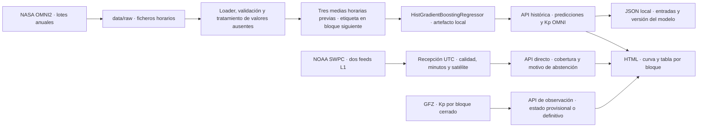

# Proyecto I: ventas y datos geomagnéticos

[Arranque y demo del Proyecto III](#proyecto-iii-aplicaci%C3%B3n-de-pron%C3%B3stico-geomagn%C3%A9tico)

Este proyecto reúne el pipeline de ventas del curso y otro con datos de NASA OMNI. En ambos cargo y valido los datos, calculo métricas y guardo los resultados desde la terminal. Elegí OMNI por mi interés en una futura predicción de Kp; aquí trabajo con la calidad de los datos.

## Organización

El código está en `src/ventas_app/` y `src/pronostico_geomagnetico/`, y sus pruebas en `tests/ventas/` y `tests/geomagnetico/`. Los datasets se descargan en `data/` (excluida de Git) y los notebooks en `notebooks/`.

En ventas utilizo `SalesRepository` y `CsvSalesRepository`, siguiendo el ejemplo de clase. Los principios SOLID aplicados están explicados en [DESIGN.md](src/ventas_app/DESIGN.md).

## Ejecución

Desde la raíz del repositorio, con Python 3.12:

```bash
python -m pip install -r requirements.txt
python scripts/download_data.py
python -m src.ventas_app.cli --input data/ventas.csv --output data/processed/ventas_validas.csv
python -m src.pronostico_geomagnetico.cli --input data/raw/omni2_2000.dat --output data/processed/metrics_2000.json
```

Ventas genera el CSV limpio, `calidad_datos.json` con recuentos e importe total y `metricas_ventas.json` con importe por región, los tres productos con mayor importe y clientes recurrentes.

OMNI genera un JSON con total de filas, filas completas e incompletas y porcentaje de completas, considerando Bz, densidad de protones, velocidad del viento solar y Kp. Para abrir los notebooks hace falta Jupyter.

## Validación

- **Ventas:** unidades y precio numéricos y mayores que cero. Se separan las filas inválidas y se calcula el importe de las válidas. El CSV del curso tiene **140 válidas y 10 inválidas**.
- **OMNI:** 55 columnas, fecha y hora válidas, años bisiestos y ausencia de instantes duplicados. Los códigos de datos ausentes se convierten a `NaN` en las cuatro variables seleccionadas.

Ambas aplicaciones utilizan excepciones propias para los errores de carga y validación.

## Tests y CI

```bash
python -m pytest -q
python -m pytest -q -m "not integration"
python -m pytest tests --cov=src.ventas_app --cov=src.pronostico_geomagnetico --cov-report=term-missing --cov-fail-under=60
```

Las pruebas usan datos en memoria, archivos temporales y los datasets descargados. Los tests no usan red; la descarga inicial sí la necesita. El 12 de octubre de 2026 pasaron **55 tests con un 98,15 % de cobertura** en local, con Python 3.14.

El workflow `.github/workflows/ci.yml` comprueba ambas partes con Python 3.12 en pushes a `main` y pull requests, con cobertura mínima del 60 %.

[Ver Actions](https://github.com/AlvaroPRuiiz/pronostico-geomagnetico/actions) ·


## Datos

Ventas procede de `3_automatizacion_e_ia/Datos/ventas.csv` del repositorio del curso.

OMNI procede de NASA/GSFC SPDF: [documentación](https://omniweb.gsfc.nasa.gov/html/ow_data.html), [archivo de 2000](https://spdf.gsfc.nasa.gov/pub/data/omni/low_res_omni/omni2_2000.dat) y [condiciones de citación](https://omniweb.gsfc.nasa.gov/html/citing.html). Se pide reconocer OMNIWeb y citar *OMNI Hourly Data*, DOI `10.48322/1shr-ht18`, con fecha de acceso. La licencia del código no se aplica automáticamente al dataset.

Fecha de descarga original: aproximadamente entre el 5 y el 7 de octubre de 2026.

El script descarga el archivo completo `data/raw/omni2_2000.dat`: **8784 filas y 55 columnas**, con los registros horarios del año 2000. Ocupa unos 2,9 MB y cumple el tamaño indicado en clase. Todos los datasets y resultados generados quedan excluidos de Git. El script también descarga el CSV de ventas desde una versión fija del repositorio del curso.


## Proyecto II: pronóstico geomagnético

El modelo estima el Kp del siguiente bloque de tres horas UTC. Usa las
medias de Bz, densidad de protones y velocidad del viento solar de las
tres horas previas a la emisión. El Kp del bloque pronosticado se usa
como etiqueta en entrenamiento y evaluación.

Desde la raíz del repositorio, con el entorno virtual activo:

```bash
python -m pip install -r requirements.txt
python scripts/download_data.py --omni-years 2000 2025
python -m src.pronostico_geomagnetico.train
python -m src.pronostico_geomagnetico.predict --input data/raw/omni2_2023.dat --model data/processed/modelo_kp.joblib --emision "2024-01-01 00:00" --provider mock
```

La configuración del modelo se eligió en validación (2022–2023).
El Boosting final se entrenó con 2000–2023 y se evaluó en 2024–2025.
El test comparó los tres métodos sobre 5.703 emisiones, de las cuales
249 tenían Kp observado ≥ 5.

| Método | MAE global | MAE con Kp ≥ 5 |
| --- | ---: | ---: |
| Persistencia | 0,863 | 1,551 |
| Regresión lineal | 0,745 | 1,780 |
| Gradient Boosting | 0,675 | 1,335 |

La persistencia supone un margen de tres horas tras el cierre del bloque
para disponer de su Kp. La evaluación es retrospectiva sobre OMNI.

Scikit-learn calcula el Kp. El cliente de IA recibe el resultado y el
intervalo para redactar un resumen. El modo `mock`, usado en los tests,
devuelve la instrucción recibida sin llamar a la API. El modo `hf` está
preparado para Hugging Face Inference Providers con `openai/gpt-oss-20b`;
la llamada real no se ha probado.

El cliente utiliza la tarea `chat_completion`. En GitHub Actions se ejecuta con el proveedor `mock`, sin credenciales ni llamadas externas.

Los datos horarios de NASA OMNI están identificados como CC0 1.0 en su
[ficha de metadatos](https://spase-metadata.org/NASA/NumericalData/OMNI/PT1H).

## Proyecto III: aplicación de pronóstico geomagnético

La web sirve dos recorridos desde FastAPI. **Directo** descarga y valida viento solar NOAA, indica el próximo bloque UTC completo y explica por qué el modelo se abstiene. **Reproducción histórica** ejecuta el modelo del Proyecto II sobre OMNI2 y compara sus resultados con el Kp observado. La descarga, la transformación, la inferencia y la API siguen la [plantilla E2E](https://github.com/dmartincc/dsia-26-27/tree/main/4_desarrollo_end_to_end/plantilla_proyecto) del [enunciado del curso](https://github.com/dmartincc/dsia-26-27/blob/main/proyectos/proyecto_iii/README.md).

### Empaquetado local

Desde la raíz del checkout, con Python 3.12 o 3.14. El arranque requiere una descarga inicial y un entrenamiento manual. PowerShell:

```powershell
python -m venv .venv
.\.venv\Scripts\python.exe -m pip install -r requirements.txt
.\.venv\Scripts\python.exe scripts/download_data.py --omni-years 2000 2025
$env:OMP_NUM_THREADS = '2'
.\.venv\Scripts\python.exe -m src.pronostico_geomagnetico.train
.\.venv\Scripts\python.exe -m uvicorn src.pronostico_geomagnetico.web:crear_app --factory --host 127.0.0.1 --port 8000
```

En Linux y macOS usa `.venv/bin/python` para los comandos del entorno virtual y `export OMP_NUM_THREADS=2`. Abre [la web local](http://127.0.0.1:8000), [la documentación de la API](http://127.0.0.1:8000/docs) o [la salud del servicio](http://127.0.0.1:8000/health). Para la demo usa **2 de enero de 2025**. Las rutas de modelo, OMNI y auditoría pueden configurarse copiando `.env.example` a `.env`. Ejecuta el servicio desde la raíz y carga solo artefactos Joblib de confianza generados por `train`. El entrenamiento guarda el modelo en `data/processed/`; Uvicorn lo carga una vez al arrancar.

### Arquitectura



**Control de ejecución.** La descarga y el entrenamiento son lotes iniciados desde la CLI. Los botones disparan consultas HTTP bajo demanda, que procesan las respuestas NOAA y GFZ en memoria. Uvicorn registra salud del modelo al arrancar, accesos, incidencias de proveedor y resultados históricos. Los datos descargados, el modelo y la auditoría quedan bajo `data/`, excluido de Git. El servidor funciona sin credenciales. El cliente generativo `mock` etiqueta su texto como simulado y no participa en el cálculo de Kp.

### Alineación y fuentes

| Variable del modelo | OMNI2 horario | NOAA SWPC RTSW |
| --- | --- | --- |
| Bz | Componente **GSM**, nT, promedio horario | `bz_gsm`, nT. El feed incluye también `bz_gse` |
| Densidad de protones | cm⁻³, normalizada entre instrumentos según OMNI | `proton_density`, cm⁻³ |
| Velocidad del viento | km/s, magnitud del flujo | `proton_speed`, km/s |
| Tiempo y procedencia | Promedios referidos a la Tierra, propagación en resolución fina y selección entre sondas | Medición de un minuto en L1, `time_tag` UTC, `source` por fila y `active` por instrumento |

- **Directo.** Para una decisión `D`, el objetivo es `[B, B+3h)`, donde `B` es el siguiente múltiplo de tres horas UTC estrictamente posterior a `D`. Se elige `D` tras recibir y procesar ambas respuestas. El instante `emision` queda vacío cuando el sistema se abstiene. El diagnóstico cuenta minutos en `[floor_min(D)-3h, floor_min(D))`. Solo empareja campo y plasma del mismo minuto y satélite activo. Exige valores finitos, densidad y velocidad positivas, muestras y calidad general cero. Descarta banderas adversas, medidas futuras, el minuto aún abierto al recibir cada producto y duplicados conflictivos. Un duplicado idéntico cuenta una vez. Los 180 minutos y el máximo de 10 minutos de antigüedad son umbrales conservadores del diagnóstico. La antigüedad mide tiempo desde el último minuto válido emparejado, incluida la latencia total hasta la decisión. La descarga no revela cuándo publicó NOAA cada fila. [Producto NOAA](https://www.spaceweather.gov/products/solar-wind) · [Aviso de cambio de endpoints](https://www.weather.gov/media/notification/pdf_2026/scn26-21_Data_Format_Changes_Impacting_SWPC_Products.pdf).
- **Compatibilidad y bloqueo.** Para predecir un bloque que empieza en `B`, sklearn espera tres promedios horarios OMNI válidos de `[B-3h, B)`. Esa ventana terrestre aún está abierta para cualquier `D < B`. Los minutos L1 tienen otras marcas temporales: NASA usa posición y velocidad, agrega tras propagar, y aplica selección y calibración entre instrumentos. Para el campo de ACE y Wind, la interpolación retrospectiva de velocidad puede usar la siguiente muestra válida. NOAA también ofrece viento propagado para la frontera de su modelo Geospace, a 32 radios terrestres, con una marca de llegada estimada. Usarlo exigiría demostrar equivalencia con OMNI2 y disponibilidad de la ventana completa antes de emitir. El endpoint comprueba el feed operativo y devuelve `sin_pronostico` aun si el diagnóstico L1 tiene cobertura completa. [NASA OMNI2, secciones 12–13](https://omniweb.gsfc.nasa.gov/omniweb/html/ow_data.html) · [NOAA Geospace](https://services.swpc.noaa.gov/products/geospace/) · [Descripción NOAA](https://www.swpc.noaa.gov/index.php/products/real-time-solar-wind).
- **Histórico.** Los registros OMNI de horas `B-3h`, `B-2h` y `B-1h` identifican horas completas y distintas. Se promedian con el mismo peso. El Kp, codificado por OMNI en décimas y repetido en el bloque `B`, se lee por separado para evaluar. `referencia_retrospectiva` marca `B`; la recepción original y la emisión operativa son desconocidas. Se guarda el instante de consulta, ventanas, variables exactas, fuente, archivos, resultado, observaciones disponibles y hash SHA-256 del Joblib. Conserva el artefacto que corresponda al hash para repetir una inferencia. Los datos de 2024–2025 se usan para demostración o evaluación. El MAE indicado en Proyecto II mide la reproducción retrospectiva, y sigue pendiente una evaluación operativa.
- **Kp observado.** GFZ entrega una marca de inicio de bloque. La API solicita exactamente esa marca tras el cierre y comprueba que coincida y esté en escala 0–9. `pre` indica provisional y `def` definitivo. Puede haber un retraso y revisiones posteriores. La descripción de GFZ registra 5–10 minutos típicos de llegada de los datos de estaciones y explica el recálculo posterior. La gráfica histórica usa el Kp de OMNI. Su selector permite contrastar un bloque con GFZ y ver el error absoluto. [API GFZ](https://kp.gfz.de/en/data) · [Metodología GFZ](https://doi.org/10.1029/2020SW002641).

### API y comprobaciones

| Método y ruta | Resultado |
| --- | --- |
| `GET /` | Página HTML que consulta la API del mismo servidor |
| `GET /health` | Estado y versión del modelo local |
| `POST /api/pronostico` | Diagnóstico actual y próximo bloque UTC |
| `POST /api/historico?dia=2025-01-02` | Reproducción por bloques, comparación y registro local |
| `GET /api/observacion?bloque=2025-01-02T03:00:00Z` | Kp GFZ para ese bloque cerrado. Sin parámetro usa el último cerrado |

```powershell
.\.venv\Scripts\python.exe -m pytest tests
.\.venv\Scripts\python.exe -m pytest tests -m "not datasets" --cov=src.ventas_app --cov=src.pronostico_geomagnetico --cov-report=term-missing --cov-fail-under=60
```

La primera orden usa también los datasets ya descargados. El workflow ejecuta la segunda con archivos temporales y respuestas de prueba, sin descargar datos de NOAA, GFZ ni OMNI.

**Verificación del 23 de noviembre de 2026 (UTC).** En un entorno virtual nuevo con Python 3.14.7 se descargaron los 26 archivos anuales y se ajustó el estimador con 68.251 ventanas de 2000–2023. Pasaron 74 pruebas en local, incluidas las tres que usan los datasets completos. La orden de CI pasó con 71 pruebas y 80,68 % de cobertura.

- **Descargas reales.** Los dos endpoints RTSW y la API GFZ respondieron HTTP 200. El antiguo `mag-1-day.json` respondió 404. A las 19:03 UTC el producto largo de Geospace devolvió 9.871 minutos con fecha de medición entre el 16 de noviembre a las 19:02 y el 23 a las 18:59. Su última llegada estimada era a las 20:04 UTC. A esa hora no permitía completar la ventana terrestre que terminaba a las 21:00 UTC. [Índice de productos NOAA](https://services.swpc.noaa.gov/products/geospace/).
- **Navegador y backend.** Edge ejecutó los botones contra Uvicorn en localhost y comprobó cinco respuestas HTTP 200, la curva dibujada, ocho filas históricas y el mock identificado. El primer bloque del 2 de enero de 2025 obtuvo Kp **3,54**, frente a **3,30** en OMNI y **3,33** definitivo en GFZ. A las 19:02 UTC, NOAA aportó **176/180** minutos emparejados de **SOLAR1**, con unos **5 min** de antigüedad. La web mostró `sin_pronostico` para **21:00–00:00 UTC** y GFZ devolvió **1,67 provisional** para el último bloque cerrado, **15:00–18:00 UTC**.

### Demo de seis minutos

| Tiempo | Acción |
| --- | --- |
| 0:00–0:45 | Presentar el bloque Kp UTC y recorrer el diagrama de arquitectura. |
| 0:45–2:00 | Actualizar directo. Leer recepción, cobertura, satélite y próximo bloque. Explicar la abstención comparando la ventana L1 con la requerida por OMNI. |
| 2:00–3:30 | Reproducir el 2 de enero de 2025. Interpretar las curvas y la tabla. Mostrar el JSON de auditoría y el mock etiquetado. |
| 3:30–4:30 | Elegir un bloque histórico y contrastar con GFZ. Consultar por separado el último bloque cerrado y explicar el estado provisional. |
| 4:30–5:15 | Abrir `/health` y explicar el hash del modelo. Indicar que solo se entrenó con 2000–2023. |
| 5:15–6:00 | Mostrar CI offline y la evidencia del recorrido en navegador. Cerrar con la limitación de compatibilidad y disponibilidad temporal del pronóstico en directo. |
